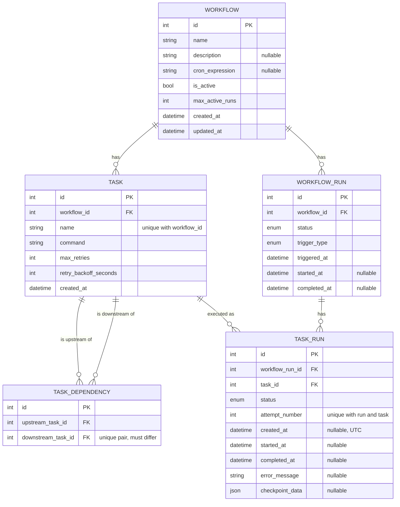
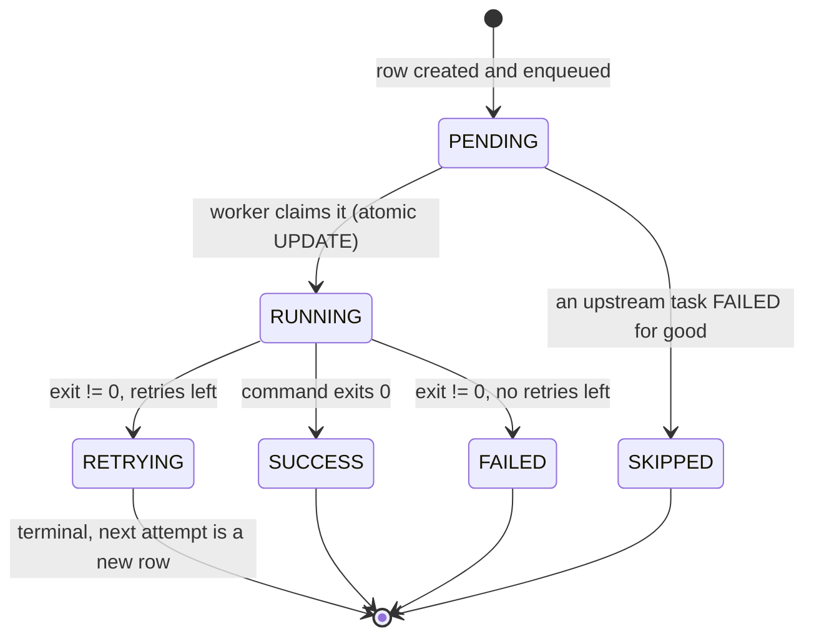
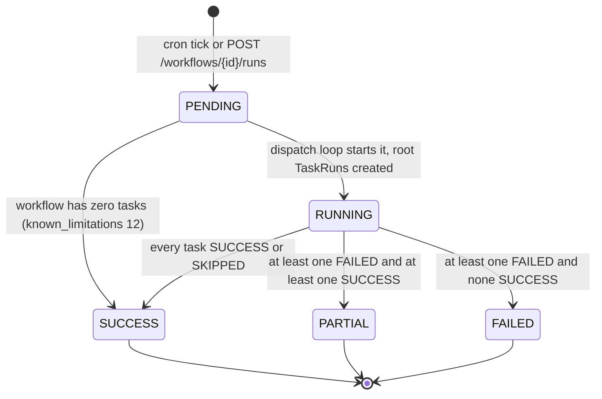
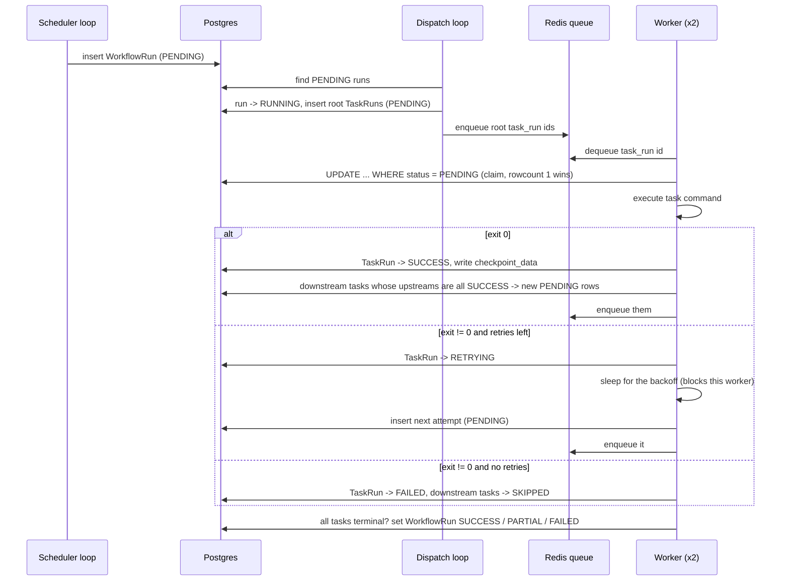
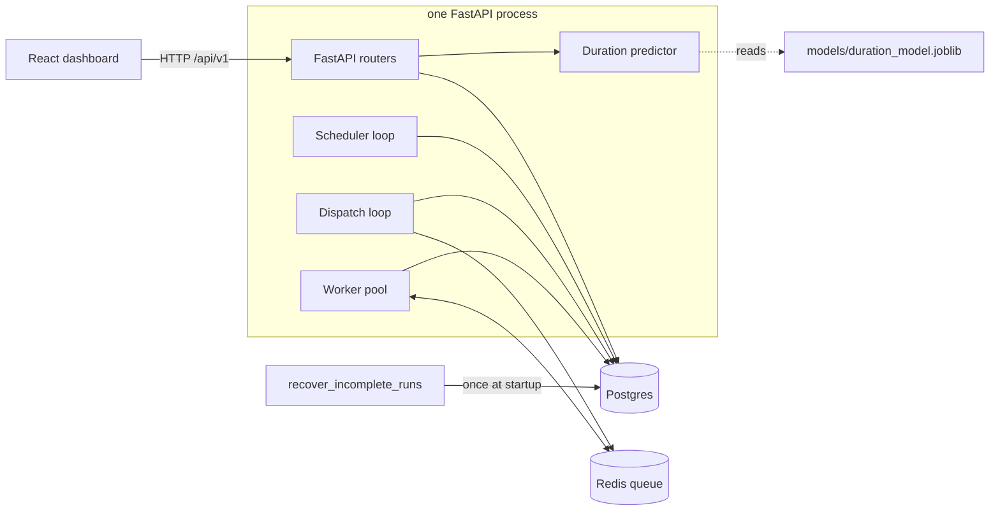

# Diagrams

Mermaid, so GitHub renders them in place. Each one is drawn from the code, not from the
original spec; the source file is named under each diagram so it can be re-checked.

## 1. Entity-relationship diagram

Source: `backend/app/models/entities.py`. All foreign keys are `ON DELETE CASCADE`, so deleting a
`Workflow` removes its tasks, edges, runs and task runs.

## 2. TaskRun state machine

Source: `VALID_TRANSITIONS` in `backend/app/engine/retry_policy.py`. `RETRYING` is terminal for a
row: a retry is a NEW row (next `attempt_number`) that starts at `PENDING`. This is what the
unique constraint on `(workflow_run_id, task_id, attempt_number)` requires.

Crash recovery is the one deliberate exception: `recover_incomplete_runs` moves a `RUNNING` row
back to `PENDING` at the same attempt (the process died, so the attempt never really finished).
It bypasses `validate_transition` on purpose; see the `recovery.py` docstring.

## 3. WorkflowRun state machine

Source: `scheduler.py` (creation), `worker_pool.py` (`start_workflow_run`,
`_maybe_finalize_workflow_run`).

A run is finalized only when every task's latest attempt is terminal (`SUCCESS`, `FAILED`,
`SKIPPED`). Cron will not start a new run while the number of `PENDING` + `RUNNING` runs is at
`max_active_runs`.

## 4. Life of one run

## 5. Components

